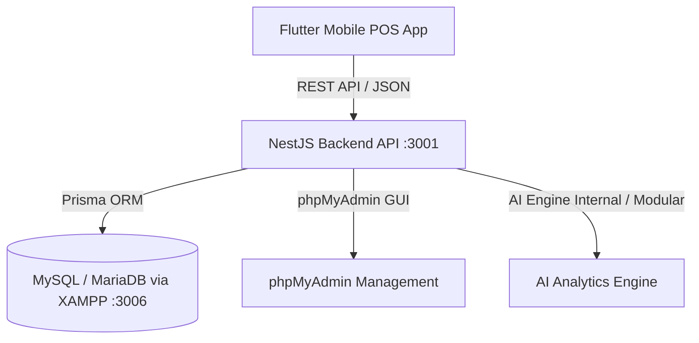

# PharmaPOS — Mobile POS & Pharmacy Management System (Indonesia)


**PharmaPOS** adalah sistem terintegrasi **Mobile Point of Sale (POS) dan Pharmacy Management System** yang dirancang untuk mengelola operasional apotek modern di Indonesia secara live, terstruktur, dan komprehensif. Sistem ini beroperasi penuh (Live Operational) dengan arsitektur enterprise-grade yang menghubungkan frontend Flutter, backend REST API NestJS, dan basis data relasional MySQL (XAMPP).

---

## 📋 Daftar Isi
1. [Fitur Utama](#-fitur-utama)
2. [Arsitektur Sistem & Tech Stack](#-arsitektur-sistem--tech-stack)
3. [Struktur Folder](#-struktur-folder)
4. [Role & Hak Akses (RBAC)](#-role--hak-akses-rbac)
5. [Akun Demo & Pengujian](#-akun-demo--pengujian)
6. [Langkah Instalasi & Setup Lokal (XAMPP & phpMyAdmin)](#-langkah-instalasi--setup-lokal-xampp--phpmyadmin)
7. [Database & Prinsip Data Bersih (Zero-Seed vs Seed Demo)](#-database--prinsip-data-bersih-zero-seed-vs-seed-demo)
8. [Modul Bisnis Khusus Farmasi Indonesia](#-modul-bisnis-khusus-farmasi-indonesia)
9. [Fitur Kecerdasan Buatan (AI)](#-fitur-kecerdasan-buatan-ai)
10. [Dokumentasi API](#-dokumentasi-api)

---

## 🌟 Fitur Utama
* **Point of Sale (POS) Cepat**: Pencarian obat instan, pemindaian barcode, diskon otomatis, dan keranjang belanja kasir.
* **Manajemen Stok FEFO (First Expired, First Out)**: Pengeluaran stok obat otomatis mengutamakan batch dengan tanggal kedaluwarsa terdekat.
* **Manajemen Batch & Expiry**: Pencatatan nomor batch pabrikan, tanggal kedaluwarsa, dan peringatan dini produk akan expired.
* **Simulasi Pembayaran Indonesia**: Mendukung pembayaran Tunai, QRIS simulasi (dinamis), Debit, Transfer Bank, dan E-Wallet.
* **Alur Validasi Resep (Prescription)**: Apoteker memeriksa resep dokter, verifikasi dosis, dan analisis otomatis interaksi obat sebelum dispensing.
* **Pengadaan (Purchasing)**: Alur Purchase Order (PO) ke PBF/Supplier, penerimaan barang (receiving), hingga pencatatan stok baru.
* **Laporan Keuangan & Operasional**: Laporan penjualan, margin keuntungan, omzet, stok menipis, dan ekspor data.
* **3 Fitur AI Terintegrasi**:
  1. *AI Prediksi Kebutuhan Stok (Demand Forecasting)*
  2. *AI Analisis Interaksi Obat & Keselamatan Resep*
  3. *AI Segmentasi Pelanggan (Metode RFM: Recency, Frequency, Monetary)*

---

## 🏗️ Arsitektur Sistem & Tech Stack



- **Frontend (Mobile)**: Flutter 3.x + Dart (Clean Architecture, Provider/Bloc State Management, fl_chart, mobile_scanner).
- **Backend (Server)**: NestJS (Node.js + TypeScript), JWT Auth, Passport, Class Validator, Swagger OpenAPI.
- **Database**: MySQL (MariaDB) via XAMPP lokal, dikelola melalui **Prisma ORM** dan dapat diverifikasi via **phpMyAdmin**.
- **Konteks Lokal**: Bahasa Indonesia, format Rupiah (`Rp15.000`), zona waktu `Asia/Jakarta`, penomoran faktur lokal.

---

## 📁 Struktur Folder

```text
POSapotek/
├── mobile/               # Aplikasi Mobile Flutter (POS Kasir, Apoteker, Gudang, Owner)
│   ├── lib/
│   │   ├── core/         # Network client, theme, formatters, storage
│   │   ├── data/         # Models, DTOs, Repositories
│   │   ├── presentation/ # Screens, widgets, state management per role
│   │   └── main.dart
│   └── pubspec.yaml
├── backend/              # REST API NestJS Server
│   ├── prisma/
│   │   ├── schema.prisma # 24 Relational Tables Definition
│   │   └── seed.ts       # Script pengisian dummy data (opsional)
│   ├── src/
│   │   ├── common/       # Guards, decorators, interceptors, filters
│   │   ├── modules/      # Auth, Products, Sales, Inventory, Prescriptions, AI, dll.
│   │   ├── app.module.ts
│   │   └── main.ts
│   ├── tsconfig.json
│   └── package.json
├── database/             # Skema raw SQL & dokumentasi kamus data
├── docs/                 # Dokumentasi arsitektur, panduan sidang & API
├── .env.example          # Template environment variable
└── README.md
```

---

## 👥 Role & Hak Akses (RBAC)

Sistem menerapkan **Role-Based Access Control (RBAC)** ketat di sisi backend guard:

| Role | Akses Utama |
|---|---|
| **Owner** | Akses penuh: Dashboard omzet, seluruh transaksi & laporan, analitik AI, audit trail, user management |
| **Manager** | Dashboard, laporan penjualan/pembelian, manajemen stok, supplier, pelanggan, promosi |
| **Admin** | Master data produk, kategori obat, supplier, pelanggan, pembelian barang (PO) |
| **Kasir** | Menu POS, scan barcode obat, keranjang belanja, checkout, simulasi pembayaran QRIS/Tunai, cetak struk |
| **Apoteker** | Verifikasi resep dokter, skrining klinis interaksi obat, persetujuan dispensing obat |
| **Staff Gudang** | Penerimaan barang dari supplier, stock opname, penyesuaian stok, monitoring batch & kedaluwarsa |

---

## 🔑 Akun Demo & Pengujian

Semua akun pengujian demo menggunakan kata sandi seragam untuk kebutuhan demonstrasi sidang:
> Kata Sandi Demo: **`Demo12345`**

| Role | Email Login | Kegunaan Demo |
|---|---|---|
| **Owner** | `owner@pharmapos.local` | Melihat ringkasan omzet, laba rugi, dan analitik AI |
| **Manager** | `manager@pharmapos.local` | Evaluasi stok dan laporan penjualan |
| **Kasir** | `kasir@pharmapos.local` | Demonstrasi transaksi penjualan di kasir |
| **Apoteker** | `apoteker@pharmapos.local` | Demonstrasi validasi resep & peringatan interaksi obat |
| **Staff Gudang** | `gudang@pharmapos.local` | Demonstrasi penerimaan barang & stok opname |

---

## 🚀 Langkah Instalasi & Setup Lokal (XAMPP & phpMyAdmin)

### 1. Jalankan XAMPP
1. Buka aplikasi **XAMPP Control Panel** di komputer Anda.
2. Klik tombol **Start** pada modul **Apache** dan **MySQL**.
3. Pastikan indikator keduanya berwarna hijau (port Apache default `80`, MySQL port `3306`).

### 2. Verifikasi phpMyAdmin & Buat Database
1. Buka browser dan akses: `http://localhost/phpmyadmin`
2. Klik tab **Databases** (Basis Data).
3. Masukkan nama database: `pharmapos_db` dengan collation `utf8mb4_general_ci`, lalu klik **Create**.

### 3. Konfigurasi Backend
1. Masuk ke folder backend:
   ```bash
   cd c:\xampp\htdocs\POSapotek\backend
   ```
2. Buat file `.env` berdasarkan template:
   ```bash
   cp ../.env.example .env
   ```
   Pastikan connection string sudah mengarah ke XAMPP lokal:
   ```env
   DATABASE_URL="mysql://root:@localhost:3306/pharmapos_db"
   PORT=3001
   ```
3. Pasang dependencies:
   ```bash
   npm install
   ```
4. Jalankan migrasi Prisma untuk membuat seluruh 24 tabel ke MySQL:
   ```bash
   npx prisma migrate dev --name init
   ```
5. Buka kembali `http://localhost/phpmyadmin` untuk memverifikasi tabel-tabel telah terbentuk secara visual!

### 4. (Opsional) Mengisi Data Dummy Demo
Aplikasi dirancang **100% toleran terhadap database kosong** (menampilkan empty state profesional). Namun jika Anda ingin mengisi data percontohan untuk presentasi sidang:
```bash
npm run seed
```

### 5. Menjalankan Backend Server
```bash
npm run start:dev
```
Server NestJS akan berjalan di `http://localhost:3001` dengan dokumentasi API Swagger di `http://localhost:3001/api/docs`.

### 6. Menjalankan Mobile App (Flutter)
1. Masuk ke folder mobile:
   ```bash
   cd c:\xampp\htdocs\POSapotek\mobile
   ```
2. Pasang paket dependencies:
   ```bash
   flutter pub get
   ```
3. Jalankan aplikasi pada emulator atau perangkat:
   ```bash
   flutter run
   ```

---

## 🛡️ Database & Prinsip Data Bersih (Zero-Seed vs Seed Demo)

* **Prinsip Bebas Ketergantungan**: Aplikasi tidak pernah melakukan hardcode ID produk atau mengasumsikan database telah terisi data seed.
* **Empty State**: Ketika database masih kosong, seluruh halaman dashboard, katalog produk, dan laporan menampilkan pesan informatif ramah pengguna (contoh: *"Belum ada transaksi pada periode ini"*).
* **Audit Trail Transaksional**: Setiap perubahan kuantitas stok dicatat dalam tabel `inventory_movements` dengan referensi faktur/PO terkait.

---

## 💊 Modul Bisnis Khusus Farmasi Indonesia

1. **FEFO (First Expired, First Out)**: Saat transaksi kasir terjadi, sistem secara otomatis memotong stok dari batch yang memiliki tanggal kedaluwarsa paling dekat.
2. **Kategori Golongan Obat**: Obat Bebas (Hijau), Obat Bebas Terbatas (Biru), Obat Keras (Merah/K), dan Narkotika/Psikotropika.
3. **Simulasi QRIS**: Menghasilkan format QRIS dinamis untuk simulasi transaksi scan & pay instan.

---

## 🤖 Fitur Kecerdasan Buatan (AI)

* **AI Stock Forecast**: Mengkalkulasi estimasi konsumsi obat bulanan berdasarkan regresi histori penjualan, lead-time supplier, dan buffer stock.
* **AI Prescription Screener**: Mendeteksi interaksi berbahaya antar zat aktif (misal: *Warfarin + Ibuprofen* -> Potensi risiko perdarahan) dan menyajikan alasan klinis bagi Apoteker.
* **AI RFM Customer Segmentation**: Mengelompokkan pelanggan apotek ke dalam segmen *Champions, Loyal, At Risk, Hibernating* untuk strategi promo personal.

---

## 📄 Lisensi & Informasi Akademik
Proyek ini dikembangkan untuk keperluan akademik capstone project / tugas akhir sistem informasi apotek dengan standar pengembangan software modern di Indonesia.
