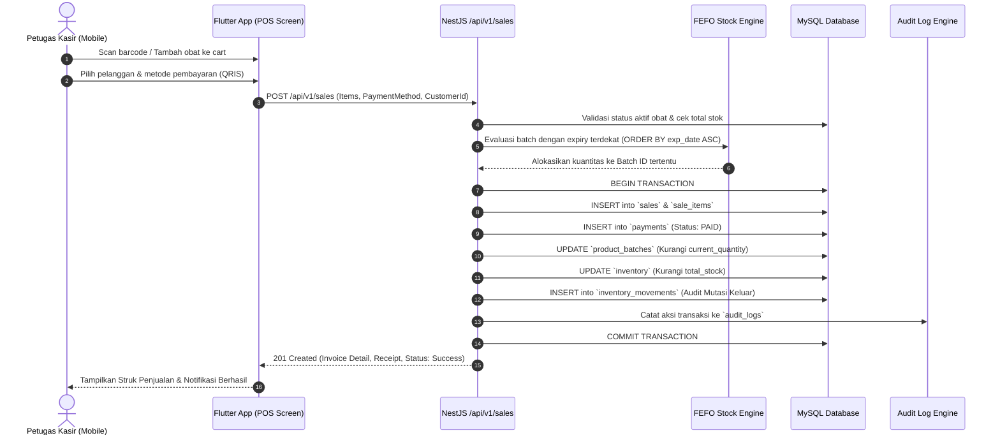

# PharmaPOS — System Architecture & Design Specification

## 1. Ringkasan Arsitektur
PharmaPOS dirancang menggunakan arsitektur **Clean Architecture & Multi-Tier Modular Monolith** yang memisahkan tanggung jawab antara:
1. **Frontend Presentation Tier (Mobile)**: Dibangun menggunakan Flutter untuk kemudahan pengoperasian kasir di berbagai tablet atau smartphone Android/iOS, mendukung responsivitas dan pemindaian barcode kamera cepat.
2. **Application Service Tier (Backend)**: Dibangun menggunakan NestJS (Node.js + TypeScript) dengan pola modular (Modules, Services, Controllers, DTOs, Guards, Interceptors) dan validasi otomatis.
3. **Data Persistence Tier (Database)**: Menggunakan MySQL (MariaDB) yang di-host secara lokal via XAMPP, dengan akses ORM menggunakan Prisma untuk memastikan type-safety mutlak dan kemudahan visualisasi data menggunakan phpMyAdmin.
4. **AI Analytics Tier**: Menyediakan modul kalkulasi prediktif (Forecasting stok FEFO, deteksi interaksi obat, dan segmentasi RFM).

---

## 2. Diagram Alur Transaksi (End-to-End Data Flow)

### 2.1 Alur Penjualan Kasir (POS Sale Flow)

---

## 3. Struktur Modul Backend (NestJS)

Setiap fitur dalam sistem diisolasi ke dalam modul mandiri dengan kontrak interface yang jelas:
* `AuthModule`: Registrasi, Login, Session token JWT, Refresh token, Hashing bcrypt.
* `UsersModule` & `RolesModule`: Manajemen akun kasir, apoteker, gudang, dan hak akses (Guards).
* `BranchesModule`: Pengaturan multi-cabang (default: Apotek Sehat Sentosa).
* `CategoriesModule`, `SuppliersModule`, `ProductsModule`: Katalog master obat dan distributor farmasi.
* `InventoryModule`: Monitoring stok, pelacakan batch kedaluwarsa, stock opname, mutasi stok.
* `SalesModule` & `PaymentsModule`: Pemrosesan keranjang belanja, invoice, dan simulasi QRIS.
* `PurchasesModule`: Pengadaan barang (Purchase Order ke PBF) dan penerimaan barang (Receiving).
* `PrescriptionsModule`: Manajemen resep obat dokter dengan verifikasi klinis apoteker.
* `PromotionsModule`: Aturan diskon persentase, nominal, dan bundle produk.
* `ReportsModule`: Agregasi data penjualan harian/bulanan, omzet, margin, dan ekspor.
* `NotificationsModule`: Peringatan otomatis stok minimum dan obat mendekati kedaluwarsa 30 hari.
* `AiModule`: Engine prediksi kebutuhan stok, skrining interaksi obat, dan analitik RFM.
* `AuditModule`: Pencatatan log seluruh aktivitas kritikal sistem.

---

## 4. Keamanan & Best Practices
* **Parameterized Queries**: Seluruh interaksi database melalui Prisma ORM secara otomatis menggunakan parameter binding, mencegah kerentanan SQL Injection.
* **Role Guards**: Setiap controller backend dilindungi oleh `JwtAuthGuard` dan `RolesGuard` yang memeriksa payload JWT secara stateless.
* **Sanitasi Input**: Menggunakan `class-validator` dan `class-transformer` untuk memastikan data yang masuk ke controller sesuai dengan tipe data yang ditentukan.
